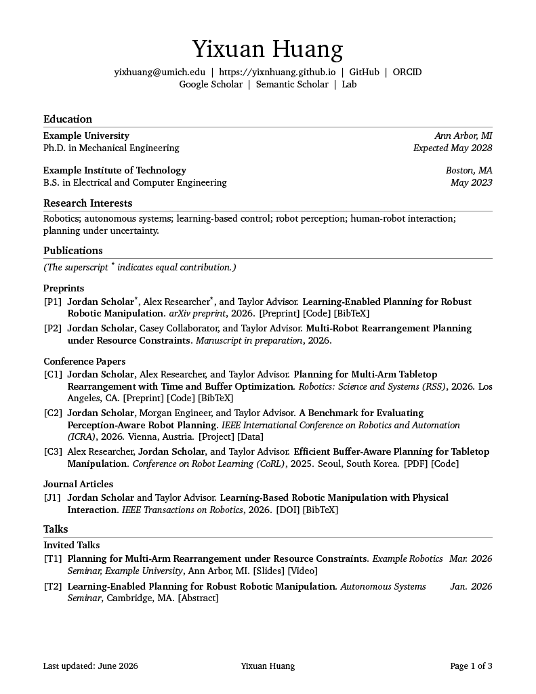
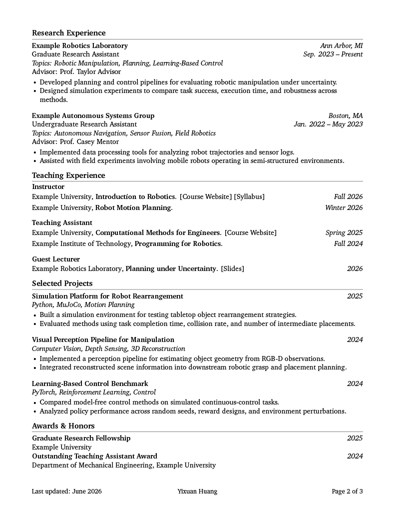
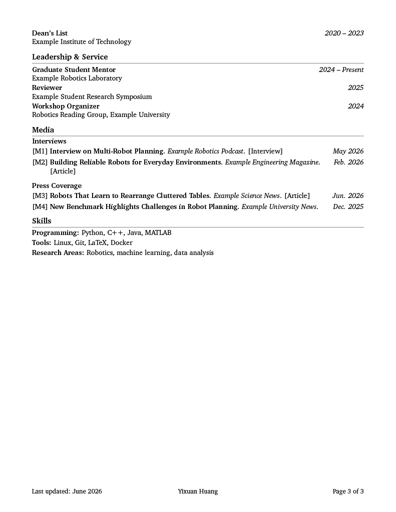

# VECTRA

An opinionated, source-available LaTeX CV and résumé system for research,
academia, and professional applications. VECTRA combines a polished fixed design,
modular content files, extensive documentation, reproducible examples, and
print-friendly PDF output.

[](LICENSE)
[](#project-status)
[](#quick-start)
[](Makefile)
[](docs/)

## Overview

**VECTRA** stands for **Versatile Experience and Career Template for Research
and Academia**.

VECTRA is built for users who want a polished academic CV or research-oriented
resume without spending time adjusting LaTeX formatting.

It is suitable for:

- Academic CVs
- Research resumes
- Graduate school applications
- Fellowship applications
- Research assistant applications
- Internship applications
- Personal academic websites
- Professional self-presentation

The template is designed around a modern academic CV layout:

- Single-column body
- Adaptive right-aligned metadata for dates, terms, and locations
- Clean section titles with subtle rules
- Compact but readable spacing
- Black-and-white print-friendly style
- Machine-readable PDF output
- Minimal visual distractions
- No icon dependency in the default style

## Preview

The preview below shows selected pages from the academic CV example generated
with VECTRA.

<p align="center">
  
  
</p>

<p align="center">
  
</p>

## Examples

Example source files are available in:

- [`examples/minimal/`](./examples/minimal/)
- [`examples/academic-cv/`](./examples/academic-cv/)

Compiled example PDFs are available here:

- [Minimal example PDF](./docs/assets/vectra-minimal-example.pdf)
- [Academic CV example PDF](./docs/assets/vectra-academic-cv-example.pdf)

The academic CV example demonstrates:

- Publications with groups, notes, indexed labels, locations, and inline links
- Talks with indexed labels and right-aligned dates
- Media entries for interviews and press coverage
- Teaching entries grouped by role
- Adaptive right-side metadata columns
- Customizable header links and constrained header width

## Important Usage Notice

VECTRA is not distributed under a conventional open-source license.

It is made available under the:

```text
Yixuan Huang Non-Commercial Attribution Template License Version 1.0
```

In short:

You may use VECTRA to create your own CV or resume.

You may edit your own personal content.

You may publish and share your generated PDF without visible attribution.

You may not redistribute, republish, mirror, repackage, sell, or create another
template project based on VECTRA.

If you want to share VECTRA with others, please cite or link to the official
repository:

```text
https://github.com/yixnhuang/vectra
```

For details, see:

- [`LICENSE`](./LICENSE)
- [`USAGE_POLICY.md`](./USAGE_POLICY.md)

## Features

- Clean academic CV design
- Modular section files
- Simple user-editable profile file
- Fixed professional layout
- Consistent entry formatting
- Research-oriented section structure
- Optional generated-date handling
- Footer system with support for update date, name, and page number
- PDF metadata support
- Print-friendly link styling
- Adaptive right metadata columns
- Indexed compact publication records
- Publication groups and publication notes
- Talk entries with indexed labels and right-aligned dates
- Media entries for interviews, press coverage, podcasts, and articles
- Role-grouped teaching entries with right-aligned terms
- Inline bracket-style links for publications, talks, media, and teaching
- Configurable header width
- Custom header contact links
- Maintainer-facing design parameters separated from user-facing content

## Repository Structure

```text
vectra/
├── README.md
├── LICENSE
├── NOTICE
├── USAGE_POLICY.md
├── CITATION.cff
├── CHANGELOG.md
├── Makefile
├── latexmkrc
├── .gitignore
│
├── src/
│   ├── vectra.cls
│   ├── vectra-core.sty
│   ├── vectra-design.sty
│   ├── vectra-layout.sty
│   ├── vectra-sections.sty
│   ├── vectra-header.sty
│   ├── vectra-footer.sty
│   ├── vectra-fonts.sty
│   ├── vectra-colors.sty
│   └── vectra-accessibility.sty
│
├── cv/
│   └── README.md
│
├── examples/
│   ├── minimal/
│   └── academic-cv/
│
├── docs/
│   ├── quick-start.md
│   ├── user-guide.md
│   ├── maintainer-guide.md
│   ├── style-rationale.md
│   ├── license-guide.md
│   └── assets/
│
└── output/
```

## Quick Start

The public VECTRA repository does not track personal CV source files in `cv/`.

To create your own local CV, copy one of the examples into `cv/`:

```bash
cp -r examples/academic-cv/* cv/
```

Then edit:

```text
cv/profile.tex
cv/settings.tex
cv/sections/
```

### 1. Edit your profile

Open:

```text
cv/profile.tex
```

Update your:

- Name
- Email
- Website
- GitHub
- ORCID, if applicable
- LinkedIn, if applicable
- Location, if desired
- PDF metadata

You may also add custom header links:

```latex
\VectraAddContactLink{Google Scholar}{https://scholar.google.com/}
\VectraAddContactLink{Lab}{https://example-lab.org}
```

You may constrain the header width:

```latex
\VectraSetHeaderWidth{0.86\textwidth}
```

### 2. Edit your CV content

Open files under:

```text
cv/sections/
```

Edit sections such as:

- Education
- Research interests
- Research experience
- Publications
- Talks
- Teaching experience
- Media
- Projects
- Awards and honors
- Leadership and service
- Skills
- Certifications

### 3. Adjust simple document settings

Open:

```text
cv/settings.tex
```

This file is for simple content-level settings, such as whether the footer date
uses the current compile date or a fixed update date.

VECTRA is not intended to be customized by changing fonts, spacing, margins, or
layout internals.

### 4. Compile

From the repository root, run:

```bash
make cv
```

The generated PDF will be placed in:

```text
output/
```

You may also compile `cv/main.tex` directly using a LaTeX editor or Overleaf,
provided that the project structure is preserved.

## What Users Should Edit

Users should edit:

```text
cv/profile.tex
cv/settings.tex
cv/sections/*.tex
```

These files contain personal CV information and content.

## What Users Should Not Edit

Users should not edit:

```text
src/
cv/main.tex
Makefile
latexmkrc
```

The files in `src/` define the VECTRA template design and layout. They are part
of the Template Source and are not intended for user customization or
redistribution.

## Academic Record Formats

VECTRA supports indexed compact records for scholarly and public-facing content.

### Publications

```text
[C1] Authors. Title. Venue, Year. Location. [Links]
```

### Talks

```text
[T1] Title. Event, Location. [Links]       Date
```

### Media

```text
[M1] Title. Outlet. [Links]                Date
```

### Teaching

```text
Role
Institution, Course Title. [Links]         Term
```

These formats are designed to remain compact while supporting long academic
records.

## Design Philosophy

VECTRA follows a compact academic design philosophy.

The default style is intended to be:

- Professional
- Academic
- Minimal
- Readable
- Consistent
- Print-friendly
- Suitable for research-oriented applications

VECTRA avoids:

- Decorative sidebars
- Excessive icons
- Overly colorful layouts
- Complex multi-column resume designs
- Manual spacing in user content
- User-facing typography customization

The goal is to let users focus on CV content while the template handles visual
consistency.

## Footer Design

VECTRA includes a structured footer system.

The footer may include:

- Last updated date
- Name
- Page number

The intended default academic footer format is conceptually:

```text
Last updated: <date>           <Name>           Page X of Y
```

This provides useful version information while keeping the document formal and
balanced.

## Documentation

Additional documentation is available in:

```text
docs/
```

Recommended reading:

- [`docs/quick-start.md`](./docs/quick-start.md)
- [`docs/user-guide.md`](./docs/user-guide.md)
- [`docs/style-rationale.md`](./docs/style-rationale.md)
- [`docs/license-guide.md`](./docs/license-guide.md)

Maintainer-facing design notes are available in:

```text
docs/maintainer-guide.md
```

This file explains internal design parameters such as spacing, margins, footer
layout, adaptive metadata columns, and typography. These settings are not part
of the public user API.

## Citation

If you use VECTRA and want to recommend or share the template, please cite or
link to the official repository:

```text
Yixuan Huang. VECTRA: Versatile Experience and Career Template for Research and
Academia. GitHub repository: https://github.com/yixnhuang/vectra
```

A `CITATION.cff` file is provided for citation metadata.

## License

VECTRA is distributed under the:

```text
Yixuan Huang Non-Commercial Attribution Template License Version 1.0
```

Generated CVs and resumes created using VECTRA may be used and shared without
visible attribution.

The template source may not be redistributed, republished, mirrored, sold,
repackaged, or used to create another template project.

See:

- [`LICENSE`](./LICENSE)
- [`USAGE_POLICY.md`](./USAGE_POLICY.md)

## Project Status

Active. VECTRA is maintained as a structured template system with versioned
documentation, examples, citation metadata, and a changelog.

## Contact

- Website: [yixuanhuang.com](https://yixuanhuang.com)
- Email: [yixhuang@umich.edu](mailto:yixhuang@umich.edu)
- Repository: [github.com/yixnhuang/vectra](https://github.com/yixnhuang/vectra)
